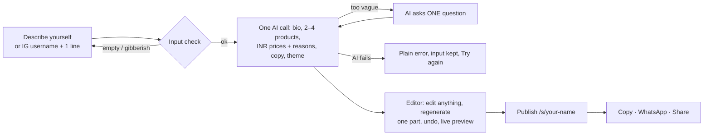

# CreatorLaunch AI: Decision Doc

**SuperProfile PM take-home · AI Storefront Generator · Abhinav Chaudhary**

## 1. The problem and my assumptions

A new creator lands on an empty store and stalls. Building the store isn't the hard part. The hard part is three decisions they've never made: **what to sell, what to charge and what to say.** So the job isn't "generate a website". It's to **make those decisions well enough that the creator only has to adjust and publish**, in their first session.

Assumptions: the main user is the Indian micro-creator (on a phone, price-sensitive buyers, never priced anything). The "expert without an audience" uses the same flow, because a description is the main input. Creators trust suggestions they can see the reasoning for and can change. And publishing an 80%-right store today beats a perfect one next week.

## 2. User and flow



It takes one screen to describe, one to edit and one tap to publish: about 20 seconds of typing, about 15 seconds of AI, then a few minutes of review.

**Main screen: chosen vs. rejected.** For the editor I chose **form cards plus a live preview** (side by side on desktop, a Preview button on phones). I rejected **tap-to-edit on the page itself**. It demos well, but on a phone the keyboard hides what you're editing, taps get mistaken for edits, and key controls have nowhere to live: product format, the "Why ₹499?" reason, regenerating one product.

```
CHOSEN: form + preview                 REJECTED: edit the page itself
┌─────────────────────────┐            ┌─────────────────────────┐
│ Product 1    ↻ New idea │            │  (RS) Riya Sharma       │
│ [Title.............]    │            │  Helping women… (edit)  │
│ [Format v]  ₹[499] ↻    │            │ 30-day plan ₹499 (edit) │
│ Why ₹499? <one reason>  │            │  #### keyboard #######  │
│ [Preview]   [Publish]   │            │  hides what you edit    │
└─────────────────────────┘            └─────────────────────────┘
```

I also rejected **chat-style onboarding**. It takes 5+ turns, so there are 5× the AI calls and a drop-off at every turn. One form plus *one* follow-up question, asked only when the input is vague, gets the same benefit.

## 3. Key decisions and trade-offs

| Decision | Why | Trade-off |
|---|---|---|
| **Description first; Instagram username optional, never scraped** | Scraping is blocked and against Instagram's terms; two lines give the AI what it needs | No real post signals yet (see §8) |
| **AI price + fixed bands per format + familiar price points** (₹99/₹499/₹999) | LLMs drift (₹523, or ₹20,000 for an ebook); the one-line reason builds trust | Bands are my judgement, not sales data yet |
| **Always one low-cost entry product (₹49–₹499)** | Price-sensitive followers buy on impulse first; the first sale is the real activation | May under-price premium creators, who can edit or ask for "more premium" |
| **Regenerate one part** (bio, one product, one price, add one), **undo on every AI change** | Creators like most of what they get; rerolling everything punishes them. Regeneration never writes to the database, so it can't damage saved work | More prompts to maintain |
| **No accounts: private edit link** | Making people sign up before they see value kills activation | Lose the link, lose edit access; OTP login comes next |
| **English, Hinglish, Hindi** | That's how these creators actually write captions | Hindi quality depends on the model |
| **Never invent facts** (followers, testimonials, results) | Trust and legal risk; there are finance and health creators | Copy is a little less punchy |

## 4. What I deliberately didn't build

- **Checkout.** SuperProfile already has payments. The buy button explains this, so it's never a dead end.
- **Accounts.** Covered in §3.
- **Instagram scraping.** Unreliable and against Instagram's terms.
- **AI images.** Slow and easy to get wrong for real people; three clean themes look more trustworthy.
- **A marketing landing page.** The first screen *is* the product.
- **An analytics pipeline.** Both key metrics come from `created_at` and `published_at`.
- **Version history.** Undo covers "I liked the old one better".

## 5. How the AI part works

- **One Gemini call** returns the whole store as structured JSON (`responseSchema`: enums for formats and themes, 2–4 products). The schema is repeated in the prompt as a fallback.
- **The prompt covers:** Indian buyer context (UPI, price sensitivity); allowed formats and price bands; "mix price levels"; audience size (small audiences → 1:1 and cohorts, large → low-cost digital); first-person, no-hype tone; **no guaranteed results, invented numbers, investment advice or medical claims**. It also states that we did *not* read their Instagram.
- **Regenerations use small, separate prompts.** Each gets the current store as context ("don't duplicate these") plus an optional instruction ("cheaper", "more Hinglish").
- **Quality control, in layers:**
  1. A cheap input check before the call (empty, too short, keyboard-mash), which lets Hinglish and Devanagari through.
  2. The model flags vague input and asks one question.
  3. The server validates every field (types, enums, counts, lengths) and strips HTML.
  4. Pricing guardrails.
  - Unvalidated output never reaches the browser.
- **Failure handling:** a 25-second timeout per attempt, and one retry on malformed output, 5xx or 429, all within the 60-second function limit. Each failure gets a plain message and a Try again button, and the creator's input is kept. Every call is logged (status, latency) in `generations`. 27 API tests and a phone and desktop browser run cover each failure type.

## 6. Success metrics

These are **proposed targets, not measured results.** SuperProfile's baselines would set the real numbers.

| Metric | Target | How it's measured |
|---|---|---|
| **First-session publish rate** (new creators who publish ≥1 product within 24h) | **+30% relative** vs. control (e.g. 20% → 26%) | 50/50 A/B at onboarding for 2 weeks; `published_at − created_at` |
| **Median time to first published store** | **Under 10 minutes** | Same timestamps |
| Guardrail: 14-day first-sale rate | **Not lower than control** | Join with orders |
| Quality signal: share of AI prices edited before publishing | If >50%, recalibrate the bands | Generated vs. published content |

## 7. Launch thought

Put a **"Build my store with AI"** card on the empty-store screen for new sign-ups, as a 50/50 test. Separately, message creators **who already stalled** (0 products) on WhatsApp: "We drafted your store. Review and publish in 2 minutes." That's the cheapest activation win available. A "Built with SuperProfile" footer turns every bio link into acquisition.

## 8. With two more weeks

1. **Official Instagram API** (the creator connects their account): bio and captions give a sharper niche and real proof points. Measure the lift against description-only.
2. **Prices calibrated on SuperProfile sales data** by niche, format and audience, replacing my hand-set bands.
3. **A "Create this product" helper**: AI outlines for the ebook or course, since making the product is the next blocker.
4. **OTP login and checkout**; views and clicks shown to creators.
5. **An eval set** of ~50 real descriptions with a scoring rubric, to compare prompts and models before shipping changes.

**How I built it:** I made the product calls (input strategy, pricing guardrails, regeneration model, flow, cut list) and used **Claude as my coding agent** for the code and tests, reviewing what it produced. Every edge case in the brief has a test, and I ran the full flow in a real browser at phone and desktop sizes.
