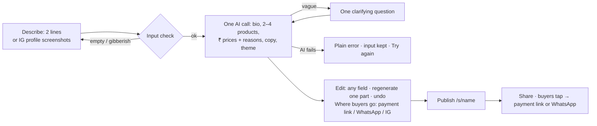

# Sell Sphere: Decision Doc

**SuperProfile PM take-home · AI Storefront Generator · Abhinav Chaudhary**

## 1. Problem and assumptions

A new creator lands on an empty store and stalls. Building the page isn't the blocker. Three decisions they've never made are: **what to sell, what to charge, what to say**. The job is to make those decisions well enough that the creator only adjusts and publishes, **in their first session**, and then to give buyers a real next step.

**Assumptions** (to validate with SuperProfile data): the primary user is the Indian micro-creator (on a phone, price-sensitive UPI buyers, never priced anything before); the "expert without an audience" uses the same flow because a description is the main input; suggestions with visible reasons get trusted and edited rather than rejected; publishing an 80%-right store today beats a perfect one next week.

## 2. User and flow



**Main screen, chosen vs rejected.** I chose **form cards plus a live preview** for the editor (side by side on desktop, a Preview button on phones). I rejected **tap-to-edit on the page itself**: it demos well, but on a phone the keyboard hides the text being edited, taps get mistaken for edits, and the controls that matter have nowhere to live (format, "Why ₹499?", the typical range, regenerate-this-product, payment link).

```
CHOSEN: form cards + preview            REJECTED: edit the page itself
+---------------------------+           +---------------------------+
| Product 1      [New idea] |           |  (RS) Riya Sharma         |
| Title [.................] |           |  Helping women... (edit)  |
| Format [v]  Rs [ 499 ] [?]|           |  30-day plan  Rs499 (edit)|
| Why Rs499? <one reason>   |           |  ######## keyboard ###### |
| Typical: Rs49-Rs999       |           |  hides what you're editing|
| [Preview]      [Publish]  |           |  no room for reasons/links|
+---------------------------+           +---------------------------+
```

I also rejected **chat onboarding**: 5+ turns means 5× the AI calls and a drop-off point at every turn. One form plus *one* question, asked only when the input is vague, gets the same benefit.

## 3. Key decisions and trade-offs

| Decision | Why | Trade-off |
|---|---|---|
| Description first, or **screenshots of your own Instagram profile**; never scraped | Scraping is blocked and against Instagram's terms. Screenshots give the AI the real bio, follower band and post themes; they aren't stored, the creator ticks "this is my account", and a handle that doesn't match the screenshot is rejected | Reads only what's visible; the official login is in §8 |
| **AI price → per-format band → Indian price point**, shown with a reason and the typical range | LLMs drift (₹523, or ₹20,000 ebooks); the reason and range build trust | Bands are my judgement, not sales data |
| Always one entry offer (≤₹499), formats must differ; duplicate or single-format sets are rejected and retried | The first impulse sale is the real activation; distinct offers feel like a business | Can under-price premium creators, who can edit or ask for "more premium" |
| **Photo + cover: upload, or AI cover as backup** (from their description and name; no faces or text) | An empty banner looks unfinished | A free Gemini key gets an AI-*designed* cover; photo-style needs billing |
| **Testimonials: creator-added, consent-ticked; AI only tidies a pasted real message** | Invented reviews mislead buyers and break fake-review rules | New creators start with none |
| **Buttons go to real destinations**: payment link → WhatsApp enquiry → Instagram → website | No dead ends and no fake checkout; most Indian micro-creators already sell over WhatsApp | Payment isn't processed inside the product |
| Regenerate one part; undo every AI change; full rewrites need confirmation; regeneration never writes to the database | Creators like most of what they get; experimenting must be safe | More prompts to maintain |
| No accounts: a private edit link (key hashed, kept in the URL fragment) | Sign-up before value kills activation | Lose the link, lose edit access; OTP is next |
| English / Hinglish / Hindi + three voices | That's how these creators write | Hindi quality depends on the model |
| Zero-dependency stack, fallback model on provider overload | Fewer moving parts; Gemini 503s were observed during the build and are now absorbed | Fewer UI niceties than a component library |

## 4. What I deliberately didn't build

**Checkout** (SuperProfile has it; buttons route to the creator's own link), **accounts**, **Instagram scraping** (Instagram blocks automated access), **AI-written testimonials** (they'd be fake reviews), **a sign-up wall** (every "Create my store" button lands on the form), **version history** (undo covers it), **a fake multi-step progress bar** (it's one AI call).

## 5. How the AI part works

- **One structured call** (Gemini `responseSchema`: format, theme and accent enums; 2–4 products), with the schema repeated in the prompt in case a model rejects the field. **Small, separate prompts** handle bio, product, price and add-product regeneration, each given the current store so it won't duplicate.
- **The prompt encodes the product thinking:** each idea must trace to the creator's words, be different in format and job, and be deliverable solo within a week or two. Prices ladder from one ≤₹499 entry offer upward. Audience size changes the mix (<5K → 1:1 and cohorts; 100K+ → low-cost digital and community). Price weighs delivery effort, buyer value and affordability. The copy contains no invented followers, credentials, testimonials or results, no guarantees, and no investment or medical claims.
- **Quality control, in layers:**
  - A cheap input check that lets Hinglish and Devanagari through.
  - A model-side input-quality flag that triggers the clarifying question.
  - Server validation of every field (types, enums, lengths, counts, distinctness), plus HTML stripping and pricing guardrails.
  - A hidden snapshot of each AI suggestion, used to measure edits.
- **Screenshot reading:** the same call takes up to 3 images and returns what it read (handle, audience band, summary). Unreadable images get a plain ask to retry or describe; the summary is saved and reused by later regenerations.
- **Failure handling:** 3 attempts within the 60s function budget; on 503/429 or a timeout it alternates primary (`3.5-flash-lite`) and fallback (`3.6-flash`, minimal thinking, capped at 20s) with backoff; malformed JSON is retried. Every failure becomes a plain message with Try again and the input kept.
- **Evidence:** 52 API tests and 70 browser checks (fake model for forced failures), live production smoke tests with real Gemini, and a 30-creator evaluation run against production (`docs/AI_EVALUATION.md`).

## 6. Success metrics (implemented as events; targets are proposals, not results)

| Metric | Definition (as implemented in `lib/metrics.js`) | Proposed target |
|---|---|---|
| **Primary: first-session publishing rate** | Sessions with ≥1 `store_published` ÷ sessions with `onboarding_started` (the first real interaction with the form). Session = anonymous id that expires after **30 min of inactivity** | **+30% relative vs. control** in a 50/50 test (e.g. 20% → 26%) |
| Secondary: time to first published store | Median minutes from `onboarding_started` to the first publish of a store created in that session, even if publishing happens in a later session | Under 10 minutes |
| Guardrail: 14-day first-sale rate | Needs order data, so **not computable in this prototype**; `/api/metrics` says so explicitly | Not lower than control |
| AI quality: material-edit rate | % of AI-suggested products that, at first publish, have a changed title or format, a price moved by >10%, or a rewritten pitch (<60% word overlap) | Watch; >50% means recalibrate the prompt and price bands |

"Published within 24 hours" is a different, broader metric. I'd report it alongside, but the first-session rate is the activation bet. Real numbers are at `/admin` (token-gated) and in `supabase/metrics.sql`. No demo data.

## 7. Launch thought

A **"Build my store with AI"** card on the empty-store screen for new sign-ups, as a 50/50 test. Separately, a WhatsApp message to creators who **already stalled** (0 products): "We drafted your store. Review and publish in 2 minutes." The footer and share buttons turn every bio link into acquisition.

## 8. With two more weeks

1. **Official Instagram login** (Instagram API with Instagram Login; Business/Creator accounts; needs Meta app review): the creator connects their account, so profile and recent posts arrive without screenshots. Measure the lift against screenshots and description-only.
2. **Prices calibrated on SuperProfile sales data**, replacing my bands.
3. **A "Make this product" helper**: AI outlines for the ebook or course, since making the product is the next blocker.
4. **OTP login and native checkout**, so the guardrail metric becomes measurable.
5. **Grow the eval set to ~100 creators, with human ratings**, run on every prompt change.

**How I built it:** I made the product calls (inputs, pricing guardrails, what the AI may and may not write, metrics, cut list) and used Claude as the coding agent, reviewing and running everything. Live testing caught real bugs I fixed: Gemini 503s and a hanging fallback, slow unpublish caching, stale JS after deploys, a DB parsing bug, and image models unavailable on a free key.
