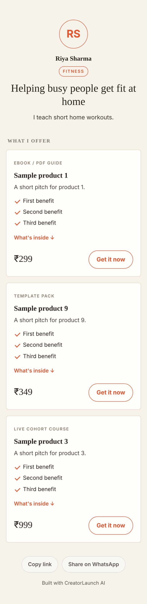
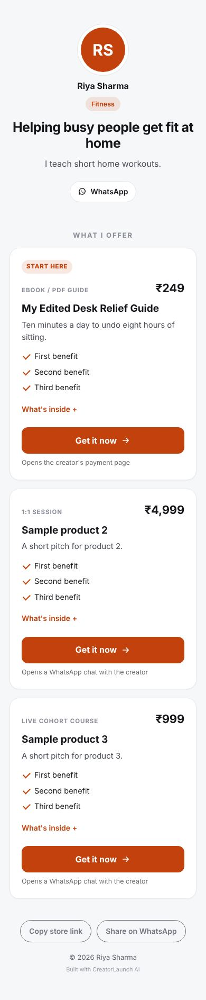
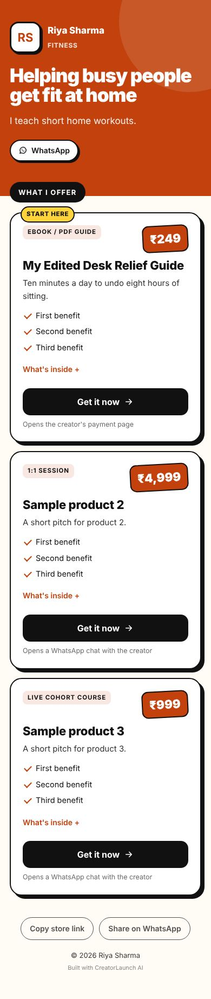
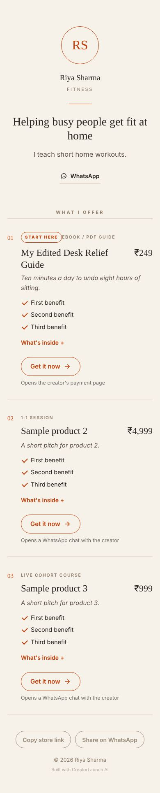
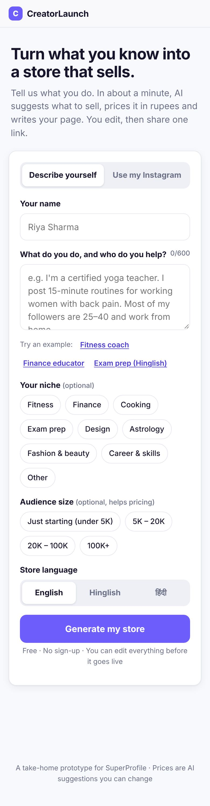
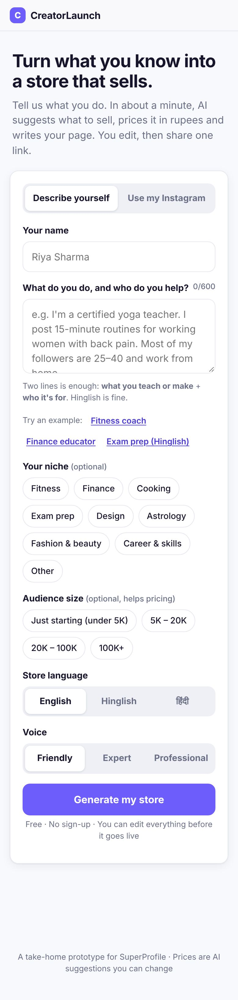
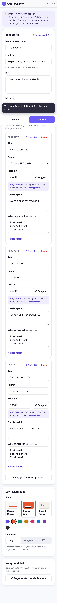
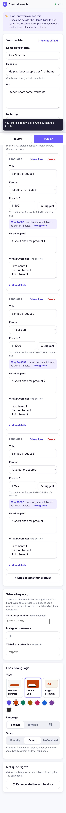

# Visual Audit (before → after)

All screenshots come from real browser runs (Playwright + Chromium, `tests/e2e.cjs`): before from the baseline commit, after from v2. Product names in the screenshots ("Sample product 2") are from the **test-only fake LLM** used for deterministic UI tests, not real AI output. Real AI output examples are in `AI_EVALUATION.md`.

## Public storefront

| Before (v1) | After (v2): Minimal | After: Bold | After: Elegant |
|---|---|---|---|
|  |  |  |  |

Desktop (1440px): [Minimal](visual/after-public-minimal-1440.jpg) · [Bold](visual/after-public-bold-1440.jpg) · [Elegant](visual/after-public-elegant-1440.jpg) · [v1 desktop](visual/before-10-public-store-desktop.jpg)

| Issue found (v1) | Change (v2) |
|---|---|
| The three themes were the same layout in different colours and fonts | **Minimal**: centred profile, card grid with the price top-right. **Bold**: full-bleed colour hero, sticker prices, thick-border offset-shadow cards. **Elegant**: editorial, serif, numbered offers separated by hairlines, no boxes |
| Desktop showed a single 560px column | 2-column grid (3-column for three products ≥1100px); Elegant keeps a narrow editorial column on purpose |
| The button only explained "no checkout"; buyers had no next step | Buttons go to the payment link → WhatsApp enquiry (pre-filled message) → Instagram → website, with a one-line "Opens …" hint; the explanation only appears when the creator set no destination |
| No contact or social row | Instagram / WhatsApp / website pills in the hero |
| No entry-offer cue | "Start here" on the cheapest paid product, a price fact rather than a "bestseller" claim |
| Four accent colours failed WCAG AA for white text (coral 3.7:1, saffron 3.4:1, emerald 4.3:1, rose 4.6 on cream 4.1) | All eight accents ≥ 4.5:1 on white and on the Elegant cream background |
| No canonical URL, favicon, Twitter tags or `og:site_name` | Added; favicon is generated from the creator's initials and accent colour |

## Create screen

| Before | After |
|---|---|
|  |  |

Changes: an inline hint ("Two lines is enough: what you teach + who it's for. Hinglish is fine"), a Voice option, mobile keyboard hints (`autocapitalize`, `enterkeyhint`, `inputmode`), and honest wait-screen copy that names the three questions the AI answers. No fake per-stage progress: it is one AI call, so staged ticks would be invented. Error state: [AI timeout](visual/after-03-ai-timeout-phone.jpg).

## Editor

| Before (phone) | After (phone) |
|---|---|
|  |  |

Desktop: [before](visual/before-09-editor-desktop.jpg) · [after](visual/after-09-editor-desktop.jpg) · [tablet 768px](visual/after-editor-tablet.jpg)

| Issue found (v1) | Change (v2) |
|---|---|
| No sense of what a "normal" price is | "Typical for this format: ₹49–₹999" under every price, next to the AI's reason |
| No way to say where buyers should go | **Where buyers go** card (WhatsApp, Instagram, website) and a per-product **Payment link**, validated as you type |
| Switching language silently rewrote the whole store | Confirmation dialog for language and voice rewrites and for unpublishing ([dialog](visual/after-05-regenerate-sheet-phone.jpg)) |
| Keyboard focus could escape dialogs | Focus is trapped inside dialogs; Escape closes them |
| Preview banner said "only you can see this" after publishing | Banner text depends on the live state ([preview](visual/after-06-preview-bold-phone.jpg), [published](visual/after-07-published-phone.jpg)) |

## Responsive verification

`tests/e2e.cjs` loads the create screen, the editor and the public page in **all three themes** at 360×800, 390×844, 430×932, 768×1024, 1024×768, 1440×900 and 1920×1080, and fails if `scrollWidth > innerWidth` (horizontal overflow). Result: **no overflow at any size** (see `TEST_REPORT.md`).
